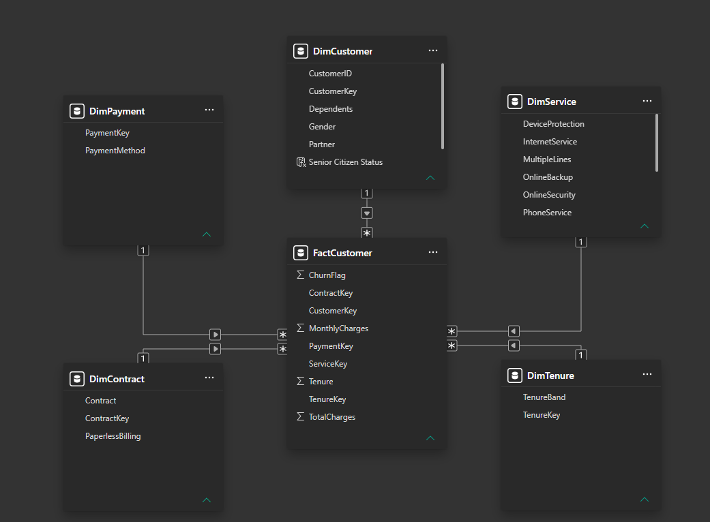
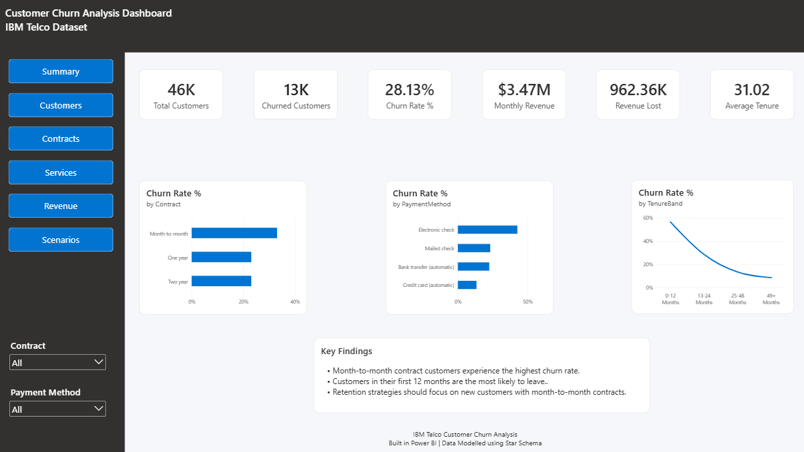
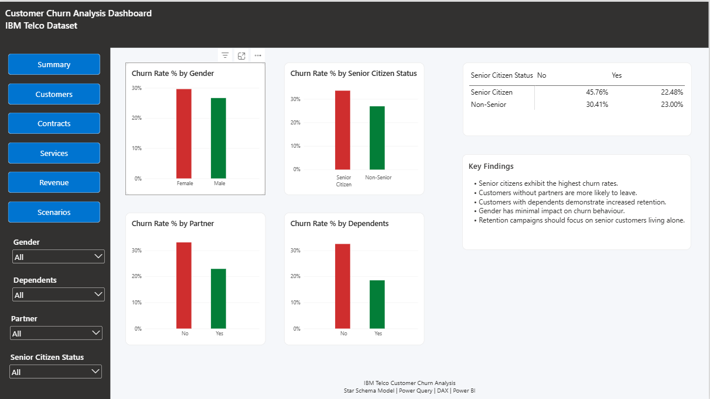
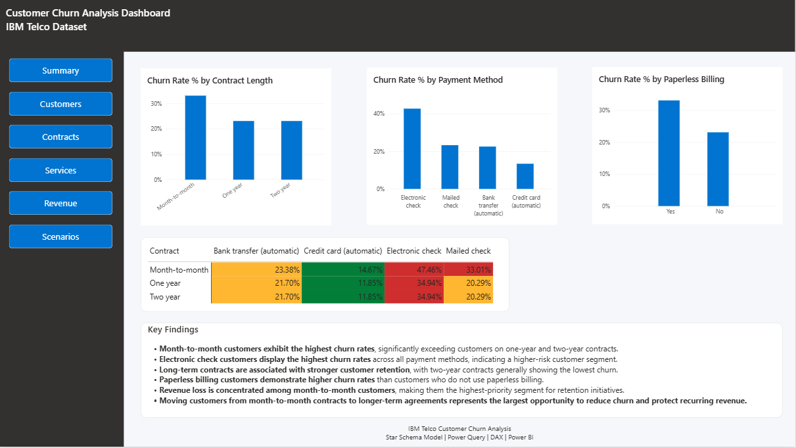
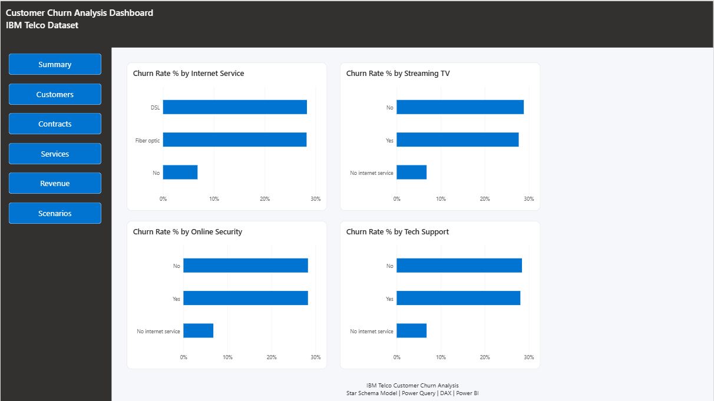
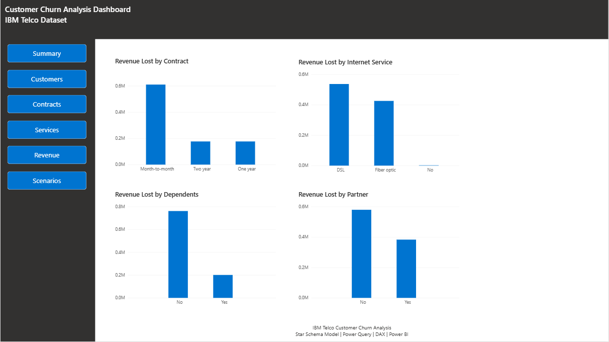
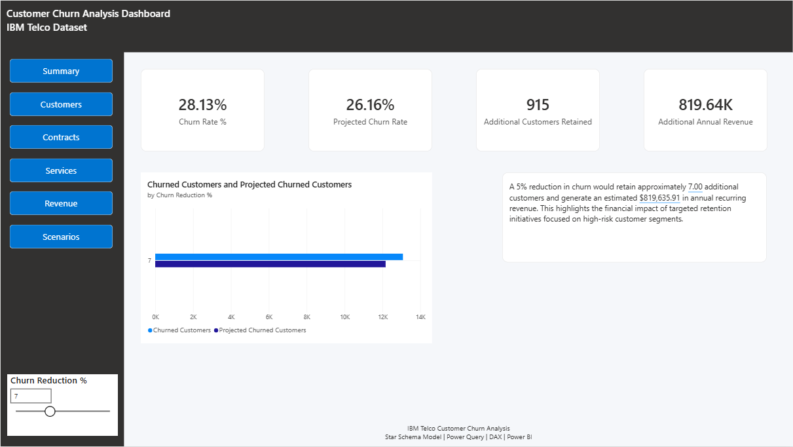

# Customer Churn Analysis & Retention Strategy Dashboard

## Overview

This project analyses customer churn using the IBM Telco Customer Churn dataset and demonstrates an end-to-end Business Intelligence workflow in Power BI.

The objective was to identify the key drivers of customer churn, understand which customer segments are most at risk, quantify the revenue impact of churn, and provide data-driven retention recommendations.

The project was designed to showcase skills relevant to Data Analyst and Business Intelligence roles, including:

- Data Modelling
- Power Query (ETL)
- Star Schema Design
- DAX Measures
- Dashboard Development
- KPI Design
- Customer Segmentation
- Business Analysis
- Scenario Modelling

---

## Dataset

**Source:** IBM Telco Customer Churn Dataset

The dataset contains customer demographic information, services subscribed to, billing information, contract types, tenure, monthly charges, and churn status.

---

# Data Modelling

Rather than using the original flat CSV file directly, the dataset was transformed into a dimensional model using Power Query.

The model consists of:

### Fact Table

- FactCustomer

### Dimension Tables

- DimCustomer
- DimContract
- DimPayment
- DimService
- DimTenure

This structure improves model performance, simplifies DAX calculations, and follows Power BI modelling best practices.

## Star Schema

---

# Executive Summary Dashboard

The Executive Summary provides a high-level view of key customer retention metrics.

### Key KPIs

- Total Customers
- Churned Customers
- Churn Rate %
- Monthly Revenue
- Revenue Lost from Churn
- Average Customer Tenure

### Key Insights

- Customers on month-to-month contracts exhibit significantly higher churn rates.
- Fibre optic customers show higher churn compared to DSL customers.
- Customers with shorter tenure are substantially more likely to leave.

---

# Customer Segmentation Analysis

This page explores how customer demographics affect churn behaviour.

### Analysis Areas

- Gender
- Senior Citizen Status
- Partner Status
- Dependents

### Business Objective

Identify high-risk customer groups that should be prioritised for retention initiatives.

---

# Contract & Payment Analysis

This page focuses on understanding the relationship between churn and customer billing preferences.

### Analysis Areas

- Contract Type
- Payment Method
- Paperless Billing
- Revenue Lost by Contract Type

### Key Findings

- Month-to-month contracts have the highest churn rates.
- Electronic check customers are significantly more likely to churn.
- Long-term contract customers demonstrate stronger retention.

---

# Service Usage Analysis

This page investigates how subscribed services influence customer retention.

### Analysis Areas

- Internet Service
- Online Security
- Online Backup
- Tech Support
- Device Protection
- Streaming Services

### Key Findings

- Customers without Online Security are more likely to churn.
- Lack of Tech Support is associated with increased churn risk.
- Certain service combinations indicate higher churn propensity.

---

# Revenue Impact Analysis

This page quantifies the financial impact of customer churn.

### Analysis Areas

- Revenue Lost by Customer Segment
- Revenue Lost by Contract Type
- Revenue Lost by Service Category
- High-Value Customer Churn

### Business Objective

Prioritise retention efforts based on financial impact rather than customer volume alone.

---

# Retention Scenario Modelling

A What-If parameter was implemented to allow stakeholders to model potential retention improvements.

### Scenario Analysis

Example:

> What would happen if churn was reduced by 5%?

Measures include:

- Additional Customers Retained
- Projected Churn Rate
- Additional Annual Revenue

This demonstrates business impact modelling beyond traditional reporting.

---

# Technical Skills Demonstrated

## Power BI

- Interactive Dashboard Development
- Custom Tooltips
- Report Navigation
- Slicers and Cross-Filtering
- Conditional Formatting

## Data Modelling

- Star Schema Design
- Surrogate Keys
- One-to-Many Relationships
- Dimension and Fact Tables

## Power Query

- Data Cleansing
- Data Transformation
- Table References
- Query Merging
- Data Type Management

## DAX

- Churn Rate Calculations
- Revenue Measures
- Retention Scenario Modelling
- KPI Development
- Time and Customer Analysis

---

# Business Recommendations

Based on the analysis:

1. Focus retention campaigns on month-to-month customers.
2. Target customers using electronic check payment methods.
3. Promote Online Security and Tech Support products to improve retention.
4. Prioritise high-revenue customer segments for retention initiatives.
5. Encourage migration to longer-term contracts through incentives and loyalty programmes.

---

# Project Outcomes

This project demonstrates the ability to:

- Transform raw data into a dimensional model
- Build business-focused KPIs
- Deliver actionable insights through visualisation
- Quantify the financial impact of customer churn
- Support decision-making through scenario analysis

---

## Tools Used

- Power BI Desktop
- Power Query
- DAX
- IBM Telco Customer Churn Dataset
